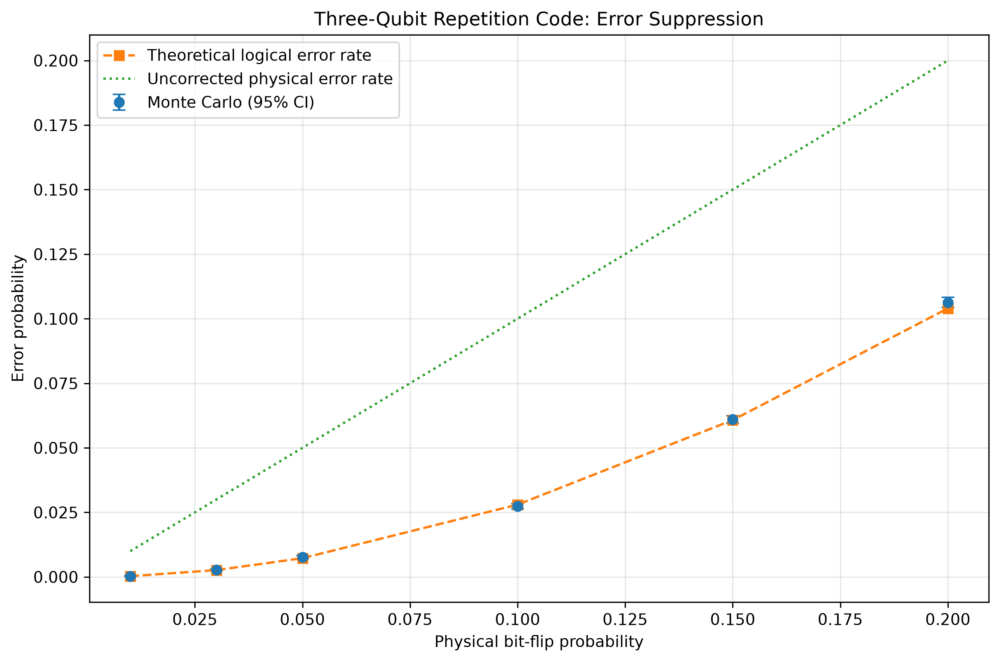

# Monte Carlo Evaluation of a Three-Qubit Repetition Code

## Abstract

This project investigates how independent physical bit-flip errors affect the logical error probability of a three-qubit repetition code. A Python simulation samples physical errors, calculates error syndromes, applies a minimum-weight correction, and estimates the resulting logical error rate. Monte Carlo estimates are compared with an analytical prediction, with Wilson 95% confidence intervals used to quantify statistical uncertainty.

For a physical bit-flip probability of 10%, the simulation estimates a logical error rate of 2.742%, compared with a theoretical prediction of 2.800%. At a physical error probability of 20%, the simulated logical error rate is 10.633%, compared with 10.400% predicted theoretically. These results illustrate the error-suppression capability of the repetition code under the assumptions of the model.

## 1. Research Question

How does the physical bit-flip probability affect the logical error rate of a three-qubit repetition code using syndrome-based decoding?

## 2. Theoretical Background

The logical computational basis is encoded as

$$
|0_L\rangle = |000\rangle,\qquad |1_L\rangle = |111\rangle.
$$

The code protects against independent bit-flip errors by encoding one logical bit across three physical qubits. The two parity checks are

$$
s_1 = e_1 \oplus e_2,\qquad s_2 = e_2 \oplus e_3,
$$

where $e_i \in \{0,1\}$ indicates whether physical qubit $i$ experienced a bit flip, and $\oplus$  denotes exclusive OR.

The decoder identifies the most likely single-qubit error consistent with the observed syndrome, assuming independent bit flips with probability \(p < 0.5\).

A logical error occurs when at least two of the three physical qubits experience bit flips. The theoretical logical failure probability is therefore

$$
\begin{aligned}
P_{\mathrm{logical}}
&= \binom{3}{2}p^2(1-p)+p^3\\
&= 3p^2-2p^3.
\end{aligned}
$$

For \(0 < p < 0.5\), this theoretical logical error probability is lower than the physical error probability \(p\).

## 3. Methodology

The simulation uses Python and NumPy to generate independent bit-flip error patterns. For each trial, it calculates the syndrome, applies the decoder's correction, and checks whether the residual error corresponds to a logical bit flip.

Six physical error probabilities are investigated: 0.01, 0.03, 0.05, 0.10, 0.15 and 0.20. Each probability is evaluated over 100,000 Monte Carlo trials using a fixed random seed to support reproducibility.

The estimated logical error rate is the number of logical failures divided by the number of trials. A Wilson 95% confidence interval is calculated for each estimate. Results, including theoretical predictions and error-reduction metrics, are exported to CSV. A plotting script visualises the simulated and theoretical error rates alongside the uncorrected physical error-rate baseline.

## 4. Results

The simulation was run for 100,000 Monte Carlo trials at each of six physical bit-flip probabilities. Table 1 compares the simulated logical error rates with their theoretical predictions and reports the 95% Wilson confidence intervals.

**Table 1. Monte Carlo results for the three-qubit repetition code.**

| Physical error probability, \(p\) | Logical failures | Simulated logical error rate | 95% confidence interval | Theoretical logical error rate | Error reduction |
|---:|---:|---:|---:|---:|---:|
| 0.01 | 31 | 0.00031 | [0.00022, 0.00044] | 0.000298 | 96.9% |
| 0.03 | 266 | 0.00266 | [0.00236, 0.00300] | 0.002646 | 91.2% |
| 0.05 | 761 | 0.00761 | [0.00709, 0.00817] | 0.007250 | 84.8% |
| 0.10 | 2,742 | 0.02742 | [0.02643, 0.02845] | 0.028000 | 72.6% |
| 0.15 | 6,103 | 0.06103 | [0.05956, 0.06253] | 0.060750 | 59.3% |
| 0.20 | 10,633 | 0.10633 | [0.10443, 0.10826] | 0.104000 | 47.0% |

*Note:* Error reduction is calculated relative to the measured physical error rate:

$$
1-\frac{P_{\mathrm{logical}}}{P_{\mathrm{physical}}}.
$$

Confidence intervals quantify sampling uncertainty in the simulated logical error rate.

The results show that the logical error rate increases with physical error probability, while the relative benefit of error correction decreases across the tested range. At \(p=0.01\), the simulation estimates a 96.9% reduction in error probability; at \(p=0.20\), the reduction is 47.0%.

At five of the six tested probabilities, the theoretical prediction lies within the corresponding 95% Wilson confidence interval. At \(p=0.20\), the theoretical value of 0.10400 falls slightly below the interval's lower bound of 0.10443. This discrepancy is worth investigating, although a single interval miss does not by itself establish an implementation error or invalidate the model.

## 5. Limitations

This is a classical error-pattern simulation of a simplified quantum error-correction code, not a full quantum-state or quantum-circuit simulation. It models independent bit-flip errors only. It does not include phase-flip errors, correlated noise, faulty syndrome measurements, imperfect gates, leakage, or the overhead of implementing correction on quantum hardware.

The simulation therefore demonstrates a limited theoretical principle rather than the performance of a practical fault-tolerant quantum computer. The confidence intervals quantify sampling uncertainty under the simulated model; they do not account for model assumptions or implementation errors.

## 6. Conclusion

The simulation compares Monte Carlo estimates with the analytical logical-error probability of a three-qubit repetition code. The results demonstrate error suppression under independent bit-flip noise for the tested physical error probabilities, while showing that the relative benefit declines as the physical error probability increases.

The project provides a reproducible foundation for further work on decoder evaluation, alternative noise models, and the effect of imperfect syndrome measurements.